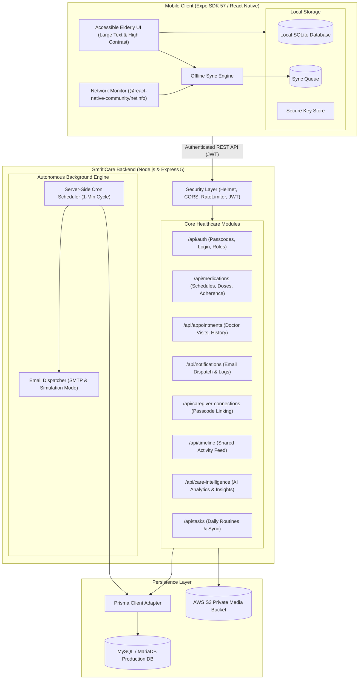

# 🧠 SmritiCare — Smart Elderly Care & Medication Management Platform

[](https://github.com)
[](https://docs.expo.dev/versions/v57.0.0/)
[](https://reactnative.dev/)
[](https://www.typescriptlang.org/)
[](https://expressjs.com/)
[](https://www.prisma.io/)
[](https://www.mysql.com/)
[](https://helmetjs.github.io/)
[](https://nodejs.org)

**SmritiCare** is an interconnected, smart healthcare management and cognitive-care ecosystem designed for elderly individuals, their family members, and professional caretakers. Built for the **MnM PromptWars × Catalyst Hackathon**, the platform goes beyond simple reminder alarms by integrating:
- **Dedicated Medication Management** with precise dose schedules, food timings, and prescribing doctor records.
- **Individual Dose-Level Adherence Tracking** with daily, weekly, and monthly adherence statistics.
- **Doctor Appointment Management** with clinical departments, reasons for visit, notes, and follow-ups.
- **Proactive Server-Side Automated Email Reminders** for upcoming doses, missed medications, medical appointments, and repeat-miss caregiver escalations.
- **Secure Passcode-Based Collaboration** enabling elderly individuals and caregivers to securely link profiles with fine-grained access control.
- **Shared Healthcare Activity Timeline** providing a real-time single source of truth for the entire care circle.
- **AI-Assisted Care Intelligence** that detects recurring missed-dose patterns, calculates adherence risk, and generates actionable caregiver recommendations without diagnosing or modifying prescriptions.
- **Offline-First Synchronization** via local SQLite and background delta reconciliation.

---

## 🏗️ System Architecture



---

## 🎯 Key Challenge Requirements & Implementation

### 1. Priority A — Medication Management
- **Full Clinical Fields**: Medicine name, dosage, measurement unit (mg, ml, drops, tablets), frequency (`ONCE_DAILY`, `TWICE_DAILY`, `THRICE_DAILY`, `AS_NEEDED`), scheduled dose times (`["08:00", "20:00"]`), start date, end date, food instructions (`BEFORE_FOOD`, `AFTER_FOOD`, `WITH_FOOD`, `NO_RESTRICTION`), prescribing doctor, and status (`ACTIVE`, `PAUSED`, `DISCONTINUED`).
- **Schedule Generation**: Idempotent automated daily dose generator creating pending dose slots for all active prescriptions.
- **CRUD Operations**: Complete endpoints for adding, editing, pausing, discontinuing, viewing today's schedule, and previewing upcoming doses in the next 24 hours.

### 2. Priority B — Medication Adherence Tracking
- **Granular Dose Records**: Tracks dose statuses (`PENDING`, `TAKEN`, `MISSED`, `SKIPPED`, `SNOOZED`) with actual confirmation timestamps, recording actor ID, and optional clinical notes.
- **Accurate Adherence Calculation**:
  $$\text{Adherence Rate} = \frac{\text{Taken Eligible Doses}}{\text{Total Scheduled Past Doses}} \times 100$$
- **Integrity Safeguards**:
  - **Zero False Misses**: Future scheduled doses can *never* be marked as missed.
  - **Duplicate Prevention**: Unique composite constraint on `[medicationId, scheduledTime]` guarantees no duplicate doses exist.
  - **Invalid Transition Protection**: Doses already confirmed as `TAKEN` or `SKIPPED` cannot accidentally be marked `MISSED`.

### 3. Priority C — Doctor Appointment Management
- **Structured Medical Appointments**: Doctor name, hospital/clinic, department/specialty (Cardiology, Orthopedics, General, etc.), appointment date & time, reason for visit, clinical notes, follow-up date, and status (`SCHEDULED`, `COMPLETED`, `CANCELLED`, `RESCHEDULED`).
- **Comprehensive Lifecycle**: Creation, rescheduling, cancellation with confirmation, upcoming visit displays, and chronological medical history tracking.

### 4. Priority D — Automated Email Notifications
- **Server-Side Background Engine**: Runs autonomously on the server every 60 seconds even when the mobile application is closed.
- **Supported Notification Types**:
  1. **Upcoming Dose Reminders**: Triggered 15–30 minutes before dose time.
  2. **Missed Dose Alerts**: Triggered 30 minutes after scheduled time if unconfirmed.
  3. **Doctor Appointment Reminders**: Dispatched 24 hours prior to scheduled consultation.
  4. **Caregiver Escalation Alerts**: Automatically notifies all connected family members and caregivers if a patient misses $\ge 2$ medication doses within a 24-hour window.
- **Enterprise Notification Reliability**:
  - **Idempotency Keys**: Unique keys prevent duplicate emails even under server restarts.
  - **Transparent Dual-Mode**: Real SMTP transmission with standard providers (Gmail, SendGrid, Amazon SES) and a verified simulation test mode when credentials are not configured.
  - **Patient Preferences**: Respects `emailNotificationsEnabled` toggle on patient profiles.

### 5. Priority E — Family & Caregiver Collaboration
- **Passcode-Based Access**: Each elderly individual has a permanent, secure passcode (e.g., `SC-PAT-XXXXXX`). Family members and caregivers connect instantly using this code without sharing sensitive passwords.
- **Collaborative Shared Timeline**: Merges medication doses, doctor visits, health alerts, and daily routine confirmations into a single chronologically sorted activity feed.
- **Ownership & IDOR Protection**: Every patient-related endpoint verifies actor relationship. Unauthorized users cannot view or modify another patient's records by tampering with route IDs.

### 6. Meaningful Innovation — AI-Assisted Care Intelligence
- **Behavioral Pattern Recognition**:
  - Time-of-day clustering (detects whether misses happen predominantly in Morning, Afternoon, or Evening).
  - Weekend vs. Weekday variance detection.
  - Medication-specific adherence tracking.
- **Objective Risk Stratification**: Assesses risk levels (`LOW`, `MODERATE`, `HIGH`, `CRITICAL`) based on recent adherence and missed dose velocity.
- **Ethical Medical Guardrails**: Strictly rule-based and transparent behavioral analytics with mandatory medical disclaimers; the AI is strictly prohibited from diagnosing, prescribing, or altering dosages.

---

## 🔒 Security Hardening

- **HTTP Security Headers**: Enforced via `helmet` with secure resource policies.
- **Brute Force & Rate Limiting**: Multi-tier rate limiting via `express-rate-limit` (500 req/15m general API limit; 50 req/15m strict authentication limiter).
- **Authentication**: Bcrypt password hashing ($\ge 10$ rounds) and JWT tokens with 7-day expiration.
- **Private Media Protection**: Memory photos and profile images stored in private AWS S3 buckets using short-lived (5-minute) presigned URLs.
- **Environment Isolation**: No hardcoded API keys or secrets; comprehensive `.env.example` provided.
- **Repository Size Compliance**: Repository is strictly optimized to **3.45 MB** (well below the 10 MB hackathon rule) with personal upload dumps and temporary files safely ignored.

---

## 🛠️ Technology Stack

| Layer | Technologies |
|---|---|
| **Mobile Client** | React Native 0.86, Expo SDK 57, TypeScript, Safe Area Context |
| **Offline Storage** | SQLite (`expo-sqlite`), AsyncStorage |
| **Backend Framework** | Node.js v24, Express 5.2, TypeScript |
| **Database & ORM** | MySQL 8 / MariaDB, Prisma ORM 7 (`@prisma/adapter-mariadb`) |
| **Security & Middleware** | Helmet, Express Rate Limit, CORS, JSONWebToken, Bcrypt |
| **Email Service** | Nodemailer (SMTP Provider + Verified Simulation Mode) |
| **Cloud Storage** | AWS S3 (`@aws-sdk/client-s3`, presigned GET/PUT) |

---

## 🚀 Setup and Running Instructions

### Prerequisites
- Node.js $\ge 20$ (Node.js v24 recommended)
- npm $\ge 10$
- MySQL or MariaDB instance (or cloud provider like Aiven/RDS)

### 1. Backend Setup
```bash
# Navigate to backend directory
cd backend

# Install dependencies
npm install

# Configure environment variables
cp .env.example .env
# Edit .env with your database connection string and settings

# Generate Prisma Client and apply migrations
npx prisma generate
npx prisma migrate deploy

# Run the backend in development mode
npm run dev

# Or build and start production server
npm run build
npm start
```
*The backend server will run on `http://localhost:5000` with the automated 60-second notification scheduler active.*

### 2. Frontend Setup
```bash
# From project root
npm install

# Start the Expo development server
npm start

# To preview in browser
npm run web

# To run on Android device / emulator
npm run android
```

---

## 🧪 Testing Suite

SmritiCare includes a comprehensive automated test suite covering all critical workflows:

```bash
# Run all backend tests (Storage, Profile S3, Medication, Adherence, Appointments, Notifications, Care Intelligence)
cd backend
npm test
```

```bash
# Run frontend profile upload recovery tests
cd ..
node src/services/profileImageUploadRecovery.test.cjs
```

### Verified Test Results (42 Tests Passing)
- ✅ **Storage & S3**: Owner-scoped UUID keys, MIME-type verification, presigned URL generation, rollback safety.
- ✅ **Profile Image Recovery**: Single-retry recovery, identity matching, invalid format rejection.
- ✅ **Medication Management**: Dosage parsing, food timings, schedule validation, idempotent dose generation.
- ✅ **Dose Adherence**: Timestamp confirmation, zero future-dose false misses, duplicate dose blocking.
- ✅ **Doctor Appointments**: Complete field validation, upcoming filter, cancel workflow.
- ✅ **Automated Notifications**: Idempotent email dispatch, preference opt-out enforcement, simulation test mode.
- ✅ **Care Intelligence**: Empty baseline handling, afternoon miss clustering, risk level evaluation.

---

## 🌐 Cloud Deployment Options

### Option 1: Live AWS EC2 Production
The backend can be deployed on AWS EC2 with attached `SmritiCareEC2S3Role` instance profile:
- API Base URL configured at: `http://43.204.221.160:5000`
- MySQL database hosted on Aiven Cloud with SSL certificate (`certs/ca-base64.txt`).

### Option 2: One-Click Cloud Deployment (Railway / Render)
SmritiCare includes zero-config deployment readiness:
- **Render**: Connect repository $\rightarrow$ Environment: `Node` $\rightarrow$ Build Command: `cd backend && npm install && npm run build` $\rightarrow$ Start Command: `cd backend && npm start`.
- **Railway**: Connect repository with Root Directory `backend` $\rightarrow$ Add `DATABASE_URL` and `JWT_SECRET`.
- **Expo Web**: Build static bundle using `npx expo export -p web` and deploy to Vercel/Netlify.

---

## 📋 Hackathon Submission Compliance Checklist

- [x] **Repository Size**: **3.45 MB** (Strictly < 10 MB; below 8 MB target).
- [x] **Git Branching**: Exactly **one branch** (`main`), clean single-branch history.
- [x] **Repository Visibility**: Cleaned of personal test images, logs, and database dumps; ready for public GitHub release.
- [x] **Problem Statement Alignment**:
  - [x] Healthcare profiles & passcode-based access.
  - [x] Dedicated medication schedule management.
  - [x] Medication adherence tracking (daily, weekly, monthly).
  - [x] Doctor appointment monitoring.
  - [x] Proactive server-side automated email reminders for upcoming doses, missed medications, medical appointments, and repeat-miss caregiver escalations.
  - [x] AI-assisted Care Intelligence module with behavioral pattern detection.
  - [x] Collaborative shared healthcare activity timeline.

---

## 📄 License
This project is licensed under the MIT License.
